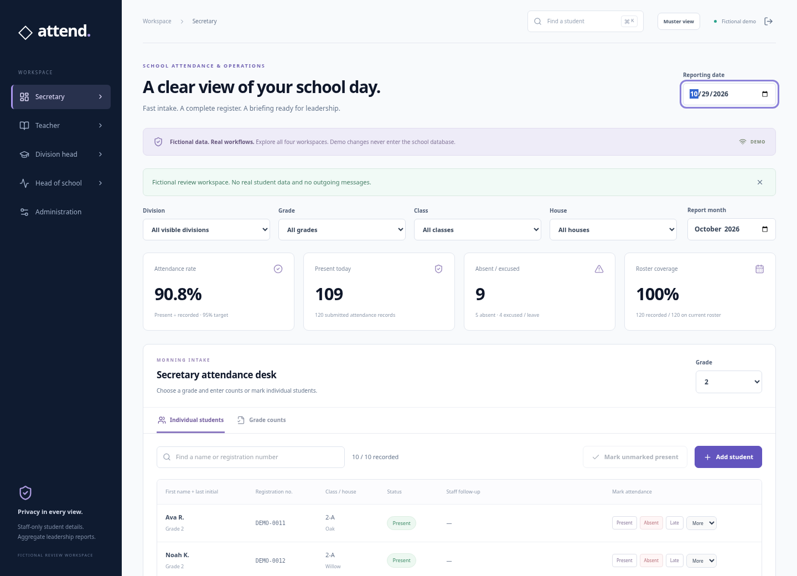
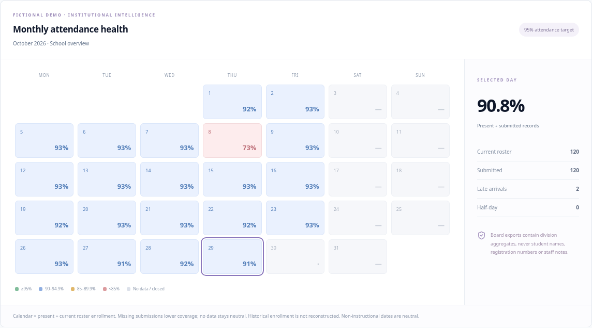

# Engineering specification review

Source: the user-supplied **Business Case & Engineering Specification Document**, version 1.0.0, October 2026. The PDF is used as requirements input. Its “approved” status and checked roadmap items are not evidence that this application or a school deployment has been accepted.

## What changed

The single-page attendance tool is now a React/TypeScript application with four workspaces, shared state, live server events, role and scope enforcement, register finalization, and institutional reporting. Existing SQLite attendance, named roster data, and history are preserved through additive startup migrations. The earlier browser UI was replaced rather than maintained as a second application.

| Area in the PDF | Review implementation | Verification / limit |
| --- | --- | --- |
| React 18+, TypeScript, Tailwind, Lucide | React 18.3, strict TypeScript 5.8, Tailwind 4, Lucide; modular components and data services | Production build and strict check run |
| Secretary morning intake | Grade counts OR individual marking; name/registration columns; absence reason, written note, contact confirmation; late arrival time | Counts and individual methods are exclusive per grade/day |
| Global search | Ctrl+K / ⌘K overlay, scoped fuzzy matching, keyboard dismissal, quick intake | Tested with fictional roster; <16 ms at school scale is not certified |
| Teacher roll call | Assigned-class roster, explicit bulk present, individual exceptions | Server rejects out-of-class reads/writes and roster edits |
| Status model | Present, Absent, Late, Excused, Half-Day; existing Leave retained | Separate categories; no silent conversion of historical leave |
| Live synchronization | Authenticated server-sent event notices; scoped refetch; polling fallback | Two browser sessions tested without full-page refresh |
| Role switching | All workspaces available in fictional review and to administrators | Real accounts see only their granted workspace; changing a view never changes server permissions |
| Division intelligence | Division, grade, class and house filters; named warning list | Division heads receive only their assigned division's students |
| Executive dashboard | School/division aggregate KPIs and monthly calendar | Executive endpoint omits roster, individual attendance, notes, and record authors |
| Calendar heatmap | 95 / 90 / 85% thresholds; weekends and configured closed dates neutral; no-data and small groups explicit | Uses current roster enrollment; historical enrollment snapshots remain future work |
| Early warnings | Below 90% present across recorded instructional days; 3 consecutive unexplained absences | Missing instructional dates break streaks; weekends/closed dates skipped. These are review signals, not findings of truancy |
| Verify & Finalize | Complete individual coverage or declared grade totals required; grade/day locks enforced at API | Only administrator can reopen; queue must be saved/discarded first |
| Audit | Staff ID/timestamp on current record; per-change status events; action audit | Previous note text is not versioned; status/actor metadata is retained |
| Outlook draft | Inline-styled fixed-layout HTML tables and RFC MIME multipart plain/HTML alternatives | Structure and content tested; actual Outlook 2016/Mac/Web/mobile acceptance remains manual |
| Board exports | Aggregate Excel workbook, monthly PNG, native browser print/PDF | Downloaded workbook parsed independently; PDF text checked for identity/note exclusion |
| Offline resilience | Attendance mutations retained in memory, optimistic pending label, reconnect retry, conflict/discard controls | Not persistent across reload/tab closure; no offline authentication or local-storage student database |
| Parent dispatch | Contact already made can be confirmed | No automated email/SMS/WhatsApp dispatch, gateway or guardian directory added |
| Enterprise persistence | Existing shared SQLite REST backend retained; domain/API boundaries separated | PostgreSQL/Cloud SQL migration, multi-instance deployment and SIS/RFID remain future phases |

## Decisions preserved from the conversation

| PDF example | Applied decision |
| --- | --- |
| Full student names and guardian details | First name + last initial and registration number, as requested. No new guardian contact collection. Staff notes intentionally remain personal data |
| Three generic Junior/Middle/Senior divisions | The user's four named school divisions and grade mapping remain authoritative |
| Automatic executive/parent distribution | Draft generation and manual review/sending remain authoritative |
| LocalStorage snapshots | No student data is persisted in browser storage; shared server persistence and an in-memory pending queue are used |
| Present / enrollment throughout | KPI/email daily attendance remains **present ÷ submitted records**, matching the user's decision. Calendar uses **present ÷ current roster enrollment**, matching the PDF; both bases are labeled |
| Emergency safety accuracy and ROI guarantees | No guarantee of live campus occupancy, emergency accuracy, time savings, legal compliance or universal performance is claimed |

## Guided review with fictional data

1. Open the fictional demo. In Secretary, choose Grade 1 and the counts tab to inspect a saved count-based register. Choose Grade 2 for the individual roster.
2. Press Ctrl+K / ⌘K and search `DEMO-0014`. Record an absence, select a reason, enter a staff note and optionally confirm that contact has already occurred. Save with Ctrl+Enter / ⌘Enter.
3. Switch to Teacher. The fictional class is scoped to one classroom. Use the class filter, open a student's history, and log a late arrival. In a real teacher account the class filter cannot expand permission.
4. Switch to Division head. Filter by grade or house and review the early-warning list and recorded-day sample size.
5. Switch to Head of school. Select a month/date in the heatmap. Inspect the denominator and coverage notes. Export Outlook EML, HTML, Excel, PNG, and print/PDF. These artifacts must contain no student names, registration numbers or staff notes.
6. Return to Secretary and finalize the complete current-day registers. Status controls lock. As a demo administrator, reopen a grade to edit it.
7. For real staff testing, configure Microsoft school sign-in and scoped assignments using SETUP.md. Test both permitted and forbidden actions with separate teacher, division and executive accounts before using approved student data.

## Remaining acceptance work

- School Entra registration, administrator scope assignments, HTTPS deployment and real tenant testing.
- Approved encrypted storage, retention, backups/restoration and jurisdiction-specific privacy/security review. This build does not certify FERPA/GDPR or WCAG conformance.
- School-specific enrollment snapshots, school-day calendars, absence weighting and minimum sample policies. Half-day is a separate full record and is not given a 0.5 attendance credit under the current present-only rule.
- Outlook-client rendering and native printer acceptance; PNG/Excel/PDF layouts on the school’s actual devices.
- School-scale performance and accessibility audit, emergency procedures and actual student-location reconciliation. The 3-second / 90-second / 60-second and ROI targets in the PDF have not been established by these tests.
- Automatic communication, guardian data, PostgreSQL migration, SIS sync, NFC/RFID and full offline persistence are deliberately not included in this review.

## Source structure

```text
web/
  App.tsx                  workspace shell, role views, filters and global search
  types.ts                 typed API and application contracts
  usePlatform.ts           auth/data state, live events, in-memory mutation queue
  components/              intake, dialogs, insights, reports, administration
  lib/                     analytics, fictional fixtures, MIME/HTML and OOXML exports
server.js                  HTTP, authentication, validation and persistence routes
platform.js                scope enforcement, finalization, snapshots and schema additions
microsoft.js               tenant-scoped Microsoft authorization-code/PKCE integration
src/                       shared CSV, attendance validation and legacy interchange helpers
test/                      domain, API permissions, migrations, analytics and export checks
```

## Review previews

These images contain fictional demonstration data only.





## Validation available to reviewers

- `npm run lint`: strict TypeScript check.
- `npm test`: 43 domain/API/identity/persistence/analytics/export checks.
- `npm run build`: production frontend build.
- `npm run test:browser`: four-workspace, keyboard, export, mobile, finalization and two-session live/offline tests using fictional, temporary in-memory databases. Uses system Chromium when installed, `PLAYWRIGHT_CHROMIUM_EXECUTABLE` when supplied, or a Playwright-installed browser. If needed run `npx playwright install chromium` first on an allowed network. The reconnect regression deliberately interrupts a write and requests an immediate retry.
- Generated PDF text was inspected for personal fields; the Excel output was independently parsed with openpyxl. Actual Outlook-client and physical-printer acceptance is still pending.
- Dependency audit at review time: zero reported vulnerabilities. This is not a security or legal compliance certification.
